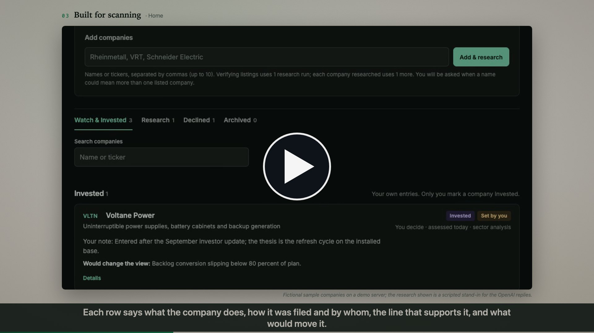

# INVEST-IGATOR

[](https://ericediger.github.io/INVEST-IGATOR/media/invest-igator-explainer.mp4)

**[▶ Watch the 2-minute explainer](https://ericediger.github.io/INVEST-IGATOR/media/invest-igator-explainer.mp4)** · **[Try the live demo](https://ericediger.github.io/INVEST-IGATOR/demo/)**

The demo is the real front end on fictional sample companies with scripted research replies; nothing is saved and no key is needed. The explainer was recorded from the same demo.

INVEST-IGATOR is a self-hosted web app for one person's investment research. You add a company by name or ticker; the app verifies the listing, collects a dated financial snapshot and a cited three-stage assessment through the OpenAI API, and files the company as **Watch**, **Research** or **Declined**. You can override any filing, and only you can mark a company **Invested**. Sector analysis discovers, researches and ranks the listed companies in a sector. Everything is kept as dated records: evidence notes, manual snapshots, bear/base/bull scenarios and a decision log. The app never executes trades and does not judge personal suitability.

It runs on your own machine with Node 20 or later, Express and SQLite. Your data stays in a local database. The only outside traffic is what you choose to connect: OpenAI for research, and free price and financials feeds (Tiingo end-of-day closes, SEC EDGAR fiscal-year financials, CoinGecko for crypto). Numbers come from feeds first and the model researches what they lack.

## Running it

```sh
npm ci
npm test
npm run build
RESEARCH_DATA_DIR=/absolute/path/for/data npm start
```

Open http://127.0.0.1:5191. `PORT` changes the port. Without `RESEARCH_DATA_DIR` the database is written to `runtime/` under the current directory; keep real data somewhere deliberate. Production needs only Node and the locked dependencies; the browser uses native ES modules, with no bundler.

To connect research, run `npm run configure-ai` in a terminal on the machine that runs the app. It asks for an OpenAI API key, stores it with owner-only permissions in the data folder and never prints it; live research needs a funded OpenAI project. `OPENAI_API_KEY` or `OPENAI_API_KEY_FILE` in the environment also work. For prices and financials, run `node scripts/configure-feeds.js` the same way to add a Tiingo token and the contact the SEC requires. Give both scripts the same `RESEARCH_DATA_DIR` as the server; without it they use `~/Library/Application Support/InvestmentResearch`, the folder the macOS service install uses.

### Installing as a macOS service

The reference installation runs the app as a launchd LaunchAgent (`com.investmentresearch.app`) with a nightly backup job (`com.investmentresearch.backup`), from an immutable `releases/<version>` folder behind a `current` symlink, with the database in `~/Library/Application Support/InvestmentResearch/`. `scripts/install-local.py` performs the first install and `scripts/upgrade-ai.py` installs every later release, finding the app folder from its own location and creating **Connect AI.command** and **Connect feeds.command** there as double-click wrappers for the two configure scripts. `scripts/install-local.py`, `scripts/verify-local.py` and `scripts/enable-trusted-lan.py` were written for one Mac and still contain that machine's absolute paths: read and adapt them before running them elsewhere.

## Home: add companies and see where they stand

Home is a dark interface built for scanning. **Invested** and **Watch** are separate sections. Each row shows the ticker and name, what the company does, the disposition with who decides (the app or you) and when it was assessed (a **Stale** mark when the assessment is older than 30 days), one line that supports the disposition, and for Watch companies one line on what would move it. **Details** opens the rest: price, listing and multiples, why the rating, the full set of triggers from the stored research (evidence still needed, catalysts to watch, next steps, the Street consensus target), *Open full research*, *Research again* and the decision control. Research, Declined and Archived are separate views.

On **Home**, type company names or tickers (comma-separated) into **Add companies** and choose **Add & research**. One research run verifies each listing (primary exchange, quote currency, what the company does); verified companies are added with a provenance note, filed as **Research**, and a snapshot-first review is queued for each automatically. If a name could mean more than one listed company, the candidates appear under the box for you to choose. Funds and unverifiable names are listed as not added. Companies already in the workspace are recognized without a paid call.

Every company carries one disposition. The app files **Watch** (rating Watch or Consider, the latter highlighted), **Research** (Research further, or no assessment yet) or **Declined** (Pass) from the latest completed assessment, and records what caused each change. The disposition control on a row lets you set any value yourself; your setting stays until you choose *App decides* again, and a later assessment that disagrees is shown as a notice, not applied. **Invested** is yours alone: the app never sets it, and marking it records the entry date, price and currency (quantity, amount and a note optional). The main list shows Watch and Invested companies; Research, Declined and Archived have their own tabs. Each row shows the exchange and currency, the latest rating with date and evidence confidence, a one-line summary, the latest dated price with its age, forward P/E, EV/EBITDA, free-cash-flow yield, market cap and revenue growth, live research progress, and links to the full research. The company page opens with the same research summary above your own notes. Research fills empty notes (thesis, risks, disconfirming evidence) with an attribution line and never overwrites what you wrote; a progress bar shows the current step and elapsed time while a run is in progress. See `docs/AI-RESEARCH.md` (Home screen workflow).

## AI research

Open **Research assistant** in the top bar for company research, a contrary-evidence review, recommendations, and persistent follow-up questions. Open **AI research** for the research inbox. Connect a server-side OpenAI API key with `npm run configure-ai` (a macOS service install also offers **Connect AI.command** in the app folder). AI functionality is documented in `docs/AI-RESEARCH.md`, including usage limits, data sent externally, evidence review, and recovery. Live research requires a funded API project.

## Sector analysis

Open **Sector analysis** in navigation, enter a sector such as “European defense” or “semiconductor equipment”, optionally the companies you already know and any criteria, and choose **Start analysis**. The server discovers the listed companies (your named companies are always included and act as a starting point), adds missing ones to the watchlist with provenance, collects a dated financial and market snapshot for each, researches and challenges each company, then ranks them. The dashboard shows the ranked recommendations with thesis, valuation, catalysts, risks, invalidation triggers, confidence and data limitations, side-by-side financial snapshots, app-computed valuation multiples, growth and margins, operating metrics, sources and data-quality notes, with drill-down to the full research for each company. One analysis counts as one daily run but makes up to 3 + 5 × companies provider requests; the estimate is shown before you start. In the research assistant, **Research & recommend** collects the same snapshot first by default, and **Financial snapshot only** collects it alone. See `docs/AI-RESEARCH.md` for the integrity rules (currency, period, share basis, freshness) and recommendation gating.

## Price and financials feeds

Run `node scripts/configure-feeds.js` on the machine that runs the app (a macOS service install also offers **Connect feeds.command** in the app folder) to add a Tiingo token and the contact the SEC requires. The app then fetches closing prices once per New York trading day after the close (one request per US-listed company or fund), reads fiscal-year financials from SEC EDGAR for US filers when it collects a snapshot, and tracks crypto records through CoinGecko. **Data & backups** shows the feed status and quotas; **Refresh prices now** on Home fetches on demand within the quota. Every stored price carries its date, source and currency; a failed fetch keeps the last good price. The research mandate can set a lighter model for collecting and extracting and a stronger one for the analysis. See `docs/AI-RESEARCH.md` (Price and financials feeds).

## Forward EPS research

In **Financial snapshots**, expand **Forward EPS** and choose **Research Forward EPS**. The agent researches an analyst estimate and prepares the value, fiscal period, accounting basis, provenance and source fields. Review the returned draft and choose **Fill Forward EPS fields**, then save the snapshot normally. Unknown publication dates remain blank; currency/share-basis conflicts are blocked.

## Everyday use

- Open a company to see its research summary and disposition, and to edit your own notes: thesis, risks, disconfirming evidence and review reminders. Save notes explicitly. The legacy research status is kept in the record but no longer shown; the disposition replaces it.
- Add evidence with a source title, optional ordinary HTTP/HTTPS link and publication/as-of dates. Unknown dates stay unknown. A correction is a new note referring to its predecessor.
- Add a manual snapshot. Enter actual currency units (not “millions”), source and period/basis for each metric. Negative EPS/FCF are valid; P/E is unavailable for nonpositive EPS. A copied/corrected snapshot is a new record.
- Build bear/base/bull assumptions against a selected snapshot. All three share target date, fiscal EPS period and share basis. The default target is 12 months after your chosen reference date. Scenarios with missing/nonpositive EPS have no chart. Out-of-order implied prices cannot be saved.
- Record Research, Watch, Pass or Revisit with selected evidence and a snapshot/scenario. Its full research/evidence/calculation basis is preserved. Correct it by adding another decision. These actions do not execute trades.
- Archive with confirmation; restore from the Archived tab on Home. All history remains.
- Conflicting edits show an error and retain your draft. Choose **Review latest saved version**, then discard your draft or **Reapply my draft** after review. Company reapply merges only the fields you changed; conflict checking applies to the whole workspace.
- Use **Data & backups** for JSON download, immediate server backup or validated restore. Imports replace the complete workspace after preview and typing `REPLACE WORKSPACE`; the app saves a database backup first.

## Where data lives

- Data folder: `RESEARCH_DATA_DIR`, or `~/Library/Application Support/InvestmentResearch/` in the macOS service install. It holds `research.sqlite` with its WAL/SHM sidecars (never copy or remove those independently), `backups/`, `logs/` and the private key and contact files.
- LaunchAgents: `~/Library/LaunchAgents/com.investmentresearch.app.plist` and `com.investmentresearch.backup.plist`.
- Releases: `releases/<version>` folders and the `current` symlink in the app folder you choose.

Data, logs and backups are outside the release, so upgrading or selecting an older compatible release does not replace the database. The data folder, the export format identifier `investment-research` and the LaunchAgent labels keep the app's earlier name, Investment Research, on purpose.

## Access

By default the server binds only to **127.0.0.1**. There is no login and no transport encryption: whoever can reach the port can read, edit, export and restore the single workspace. Keep it on loopback or on a network you trust completely. It is not suitable for public or untrusted-network exposure.

To reach it from other devices on a trusted home network, set `RESEARCH_LAN_ADDRESS` to the server's private IPv4 address and `RESEARCH_TRUSTED_SUBNET` to that network (for example `192.168.1.0/24`) in the service environment. The app then binds that address in addition to loopback, accepts socket peers only from loopback and that subnet, and validates the exact Host and the write Origin for each address, for pages and APIs alike. Forwarded headers do not grant access. The address must exist on the machine: if it is missing, the app fails closed instead of falling back to an all-interface listener, so reserve the address in your router. Without these settings the code stays loopback-only.

## Start, stop and restart

In the macOS service install the app starts when the installing user logs in and launchd restarts it if it exits. It is unavailable while the Mac is asleep, shut down or logged out. Do not start a second process on the same port.

```sh
# Inspect
launchctl print gui/$(id -u)/com.investmentresearch.app

# Restart the installed app
launchctl kickstart -k gui/$(id -u)/com.investmentresearch.app

# Stop (until explicitly started again or next login)
launchctl bootout gui/$(id -u) ~/Library/LaunchAgents/com.investmentresearch.app.plist

# Start after stopping
launchctl bootstrap gui/$(id -u) ~/Library/LaunchAgents/com.investmentresearch.app.plist
```

## Backups and restore

In the macOS service install a launchd job runs at **02:30 local time daily** (runs after wake if the scheduled time was missed while sleeping). It uses SQLite's online backup API and verifies database integrity before publishing the backup. The latest 30 scheduled/manual backups are kept. Pre-restore backups have `pre-restore-` names and are retained separately. Failures leave earlier backups intact and are written to the backup error log.

Run a backup immediately from **Data & backups**, or:

```sh
launchctl kickstart gui/$(id -u)/com.investmentresearch.backup
```

JSON restoration is the normal recovery workflow: choose a previous JSON export in **Data & backups**, inspect the counts, and type the replacement confirmation. Failed validation, unsupported schema, duplicate IDs, invalid references and imports over 5 MB do not change existing records. A concurrent edit after preview requires a fresh preview. The export schema version is 1.

To verify a SQLite backup without touching production, from the source checkout or the active release folder:

```sh
node scripts/restore-database.js '/absolute/backup.sqlite' '/absolute/new-disposable-directory'
RESEARCH_DATA_DIR='/absolute/new-disposable-directory' PORT=5192 npm start
```

The restore command rejects an existing target directory, checks SQLite integrity, validates all relationships and compares the recovered workspace. Open http://127.0.0.1:5192 to inspect it and export JSON. Restore that JSON through the production UI. Stop the temporary process after inspection.

If the production database cannot start, stop the app, **preserve/rename the entire production data directory**, restore into a new data directory with the command above, and update the app and backup LaunchAgents to the recovered directory before starting. Never overwrite a live database. Keep the damaged directory for investigation. Restoring an older backup necessarily loses changes newer than that backup; decide that deliberately.

Automatic backups are on the same machine as the database. They protect against accidental edits or replacement and some database failures, not loss of the machine or disk; keep an encrypted copy elsewhere yourself.

## Update and rollback

The steps below are what `python3 scripts/upgrade-ai.py` automates; use that script from the source checkout for every release. It finds the app folder from its own location, so it keeps working if the folders are renamed.

1. Work in the source repository; do not edit `current` in place. Increment the application version in `package.json` and the version literal in `server/app.js`. Keep `package-lock.json`.
2. Run `npm ci`, `npm test`, `npm run build` and the browser suite. Test any migration on a restored disposable database first. Back up the live app before switching releases.
3. Copy the tested application and installed production dependencies into a **new** `releases/<version>` directory. Preserve the previous release. Do not copy runtime data into it.
4. Change the `current` symlink to the new release and restart only `com.investmentresearch.app`. Verify `/api/health`, watchlist, saving and backup creation. The app and backup jobs both resolve `current`.
5. To roll back the application, point `current` to the previous release and restart that same job. Leave the data directory untouched. Version 1.0.0 reads database/workspace schema 1 and refuses a newer database schema. If a future version migrates the schema, code rollback is allowed only if compatible; otherwise a separately approved backup recovery is required. Never silently downgrade the data.

Use an atomic symlink replacement (`current.next` → `current`) so the active path is never partially copied. `scripts/install-local.py` is for first install only; it refuses to replace an existing release or LaunchAgent.

## Scope and limits

Manual financial snapshots remain the basis for valuation scenarios and decisions; AI-collected financial snapshots are cited research records with app-computed derived values, not a market-data feed. Dispositions are research filings, not holdings; marking a company Invested records your own entry and does not place a trade. Optional AI company research, sector analysis and recommendations use paid OpenAI API requests and web search after a server key is configured. Daily closing prices and SEC fiscal-year financials come from free feeds when connected; there is no intraday quote feed, correlation analysis, actual portfolio/holdings/performance, broker connection, public sharing or notification. Review dates and triggers are displayed, not pushed as alerts. Currency and listing start unknown; users must verify them. Manual source links are stored for provenance; AI runs use web search and retain returned citations. Source provenance checks do not establish factual correctness. Evidence is plain text, not rich HTML. Arithmetic uses finite JavaScript numbers with no intermediate rounding; display rounds to four fractional digits. Single-household workspace, modest concurrency, 4 MB workspace / 5 MB request/import limit and whole-workspace conflict checks. Daily age calculations use America/New_York calendar dates.

See `docs/API.md`, `docs/ARCHITECTURE.md` and `TEST-RESULTS.md` for engineering details and verification results. Coding agents start with `AGENTS.md` and `HANDOFF.md`.

## License

MIT. See `LICENSE`.
